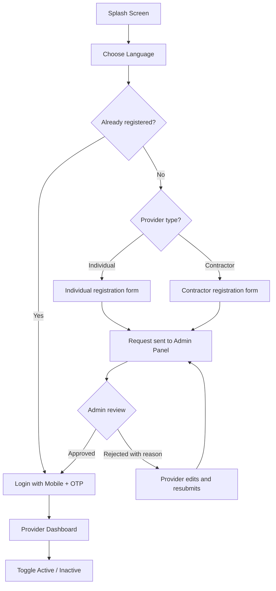

<div align="center">

# 🛠️ HIRE US

### Book trusted service providers and contractors, fast.

A gig-work marketplace connecting **residential and industrial clients** with **verified individual service providers and contractors** across Sri Lanka.


</div>

---

## 📖 About

**HIRE US** acts as an agent between clients and skilled workers such as welders, plumbers and electricians. Providers are reviewed and approved by an admin before they can take work, so clients always deal with verified people.

The first launch targets the **Colombo** and **Gampaha** districts. The apps support **Sinhala, English and Tamil**.

---

## 🧩 System Overview

HIRE US is made up of **three mobile apps**, one **admin web panel** and a shared **Spring Boot backend**.

| Component | Platform | Who uses it |
|---|---|---|
| 👷 **Provider App** | Android & iOS | Individual service providers and contractors |
| 🏠 **Residential Client App** | Android & iOS | Households booking services |
| 🏭 **Industrial Client App** | Android & iOS | Companies and industrial clients |
| 🖥️ **Admin Panel** | Web | HIRE US administrators |
| ⚙️ **Backend API** | Spring Boot | Serves all of the above |

```
 Provider App ─┐
 Residential  ─┤
 Client App   ─┼──►  Spring Boot REST API  ──►  PostgreSQL
 Industrial   ─┤              │
 Client App   ─┤              └───────────────►  Firebase
 Admin Panel  ─┘
```

---

## ✨ Features

### 👷 Provider App

- 🌐 Splash screen and **language selection** (Sinhala / English / Tamil)
- 🔐 **Mobile number + OTP** login
- 📝 Registration for two provider types:
    - **Individual Service Provider**: personal details (name, NIC, mobile number, address) plus professional details (working category such as welder, plumber or electrician, experience, certificates, working area, images)
    - **Contractor**: business name, business registration certificate, contact details, working area, business location, experience, address, business logo and other certificates
- ✅ **Admin approval flow**: every registration is reviewed before the provider can log in
- ❌ If rejected, the admin gives a **reason** and the provider can **edit and resubmit**
- 🟢 **Active / Inactive toggle** on the dashboard, so providers can show clients whether they are available

### 🖥️ Admin Panel

- Review incoming provider registrations
- Approve or reject with a reason

### 🏠 Client Apps

- Residential and industrial client apps (features coming soon)

> 🚧 More features will be documented here as each app is built.

---

## 🔄 Provider Registration Flow



---

## 🏗️ Tech Stack

| Layer | Technology |
|---|---|
| Mobile apps | Android & iOS |
| Admin panel | Web |
| Backend | Spring Boot (Java) |
| Primary database | PostgreSQL |
| Cloud services | Firebase |
| Languages supported | සිංහල · English · தமிழ் |

---

## 📁 Project Structure

```
hireus/
├── provider-app/              # Provider mobile app
├── residential-client-app/    # Residential client mobile app
├── industrial-client-app/     # Industrial client mobile app
├── admin-panel/               # Web admin panel
├── backend/                   # Spring Boot API
└── docs/                      # System design and documentation
```

> Folder names are a guide. Update them to match the repository.

---

## 🚀 Getting Started

### Prerequisites

- JDK 17 or later
- PostgreSQL
- A Firebase project
- Android Studio / Xcode for the mobile apps

### Run the backend

```bash
cd backend
./mvnw spring-boot:run
```

Then configure your database and Firebase credentials in `application.properties`.

> Setup steps for each app will be added as development progresses.

---

## 🗺️ Roadmap

- [x] System design
- [ ] Provider app: registration, login and dashboard
- [ ] Admin panel: provider approval
- [ ] Residential client app
- [ ] Industrial client app
- [ ] Payments (cash and online)
- [ ] MVP launch in Colombo & Gampaha

---

## 👥 Team

Built by a team of five full-stack developers.

---

## 📄 License

This project is currently private and all rights are reserved. A license will be added when the project is opened up.

<div align="center">

**Powered by TRAINCO (PVT) LTD**

</div>
